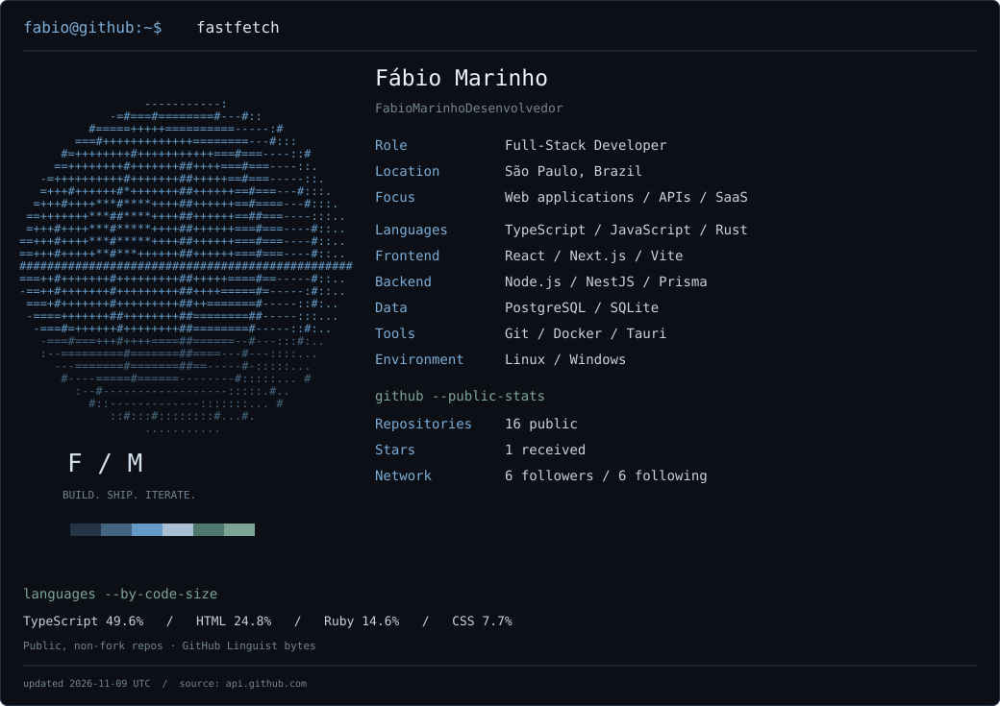

<picture>
  <source media="(max-width: 600px)" srcset="assets/terminal-mobile.svg">
  
</picture>

`fabio@github:~$ cat about.txt`

Desenvolvo aplicações web, APIs e ferramentas que resolvem problemas do dia a dia. Do frontend ao banco de dados, trabalho com TypeScript e React, backend em Node.js e aplicações desktop com Rust e Tauri.

`fabio@github:~$ ls ~/projects --featured`

- **[connections-hub](https://github.com/FabioMarinhoDesenvolvedor/connections-hub)** — Site multilíngue, blog em Markdown e experiências 3D.  
  `Next.js · React · TypeScript · Three.js`
- **[tasks](https://github.com/FabioMarinhoDesenvolvedor/tasks)** — Organizador offline para Windows, com quadros, calendário e backup local.  
  `Rust · Tauri · React · SQLite`
- **[wsn-front](https://github.com/FabioMarinhoDesenvolvedor/wsn-front)** — Website institucional da WSN Distribuidora.  
  `React · TypeScript · Vite`
- **[chamados-repo](https://github.com/FabioMarinhoDesenvolvedor/chamados-repo)** — Sistema de chamados de TI com triagem e histórico. Versão arquivada.  
  `NestJS · Prisma · PostgreSQL`

`fabio@github:~$ cat links.txt`

[Website](https://www.connectionshub.com.br/) · [LinkedIn](https://www.linkedin.com/in/fabio-marinho-3710623bb/) · [E-mail](mailto:fabiomarinho202020@gmail.com)

Informações em texto / metodologia

**Fábio Marinho · FabioMarinhoDesenvolvedor · Full-Stack Developer · São Paulo, Brasil.**

- Linguagens e stack: TypeScript, JavaScript, Rust; React, Next.js, Vite; Node.js, NestJS, Prisma; PostgreSQL e SQLite.
- Sistemas e ferramentas: Linux, Windows, Git, Docker e Tauri.
- Os números do terminal vêm da API oficial do GitHub. [Snapshot atual](assets/stats.json).
- Repositórios: somente públicos de minha propriedade. Estrelas: recebidas nos públicos que não são forks.
- Linguagens: proporção dos bytes classificados pelo GitHub Linguist nos repositórios públicos, sem forks e sem este repositório. Inclui arquivados; não mede domínio técnico nem linhas escritas por mim.
- O gráfico nativo de contribuições do GitHub fica abaixo deste README. Não confundo contribuições com commits nem publico dados de projetos privados.
- [Como o perfil é atualizado](MAINTENANCE.md).

